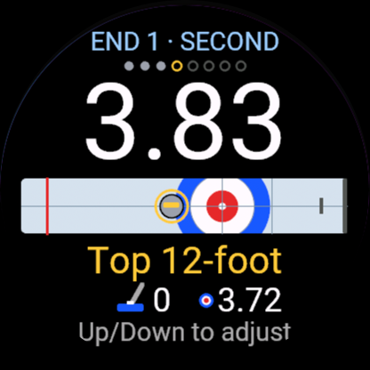
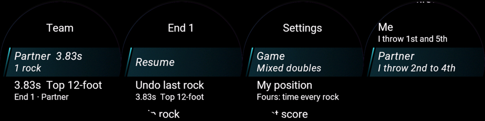

# Curling Split Timer

A Garmin Connect IQ watch app for timing your team's rocks during a game of
curling. Press Start as a rock crosses the back line and again at the hog
line: the watch shows the split and where the rock should stop. Tell it where
the rock actually stopped and its predictions learn the day's ice.

It runs on Garmin watches with five buttons: Forerunner 165, 255, 265, 570,
955, 965 and 970, fēnix 7 (all versions), epix (Gen 2 and Pro) and Enduro 3.
It's meant for club play (see
[Is it legal in a game?](#is-it-legal-in-a-game)). Free software under the
GPL 3.0.



Watch the 30-second demo: [a scripted game in the simulator](https://www.youtube.com/watch?v=r3viIWV5aks).
Get it from the [Connect IQ Store](https://apps.garmin.com/apps/f6383df1-cbab-4387-85e0-7510400479f1).

## Features

- Back-line-to-hog-line split timer, with a short buzz at each press.
- Predicted stop position for each split, shown on a drawing of the sheet,
  from guards through the house to hit weight.
- Learns the ice from where you mark rocks stopping, and remembers it
  between games. You can reset it, or forget one player's marks.
- Fours and mixed doubles. Each logged rock is credited to its thrower.
- Untimed hits, logged with one long press.
- Your own rocks: skipped for timing, and the watch asks whether you made
  each shot, for your accuracy this game and over your last 10 saved games.
- Optional end-by-end score, or a final score at the end of the game.
- Team list: score, your shots made, each teammate's average draw split,
  rocks and hits, and the last five rocks.
- Sweeping strokes counted from the watch's motion sensor.
- Undo, skip a rock, and pick up a game the app closed during.
- Saves the game as a Garmin activity with heart rate, strokes, splits,
  score and shots made.

## Install

Get it from the [Connect IQ Store](https://apps.garmin.com/apps/f6383df1-cbab-4387-85e0-7510400479f1)
in the Connect IQ app on your phone (while it's in Garmin's review, it may not
show up yet). Or build it and copy it onto the watch over USB: see
[Development](#development).

Recommended: on the watch, set Settings > System > Display > During
Activity > Timeout to Extended. The app turns the screen on whenever you
press a button, but Garmin doesn't let apps keep it on, so with a short
timeout it goes dark between rocks.

## Playing a game

Before your first game, hold **Up** to open the settings and choose the game
(Fours or Mixed doubles) and, for fours, your position. You can't time your
own throws, so the app skips your rocks.

The buttons:

| Button | Ready | Timing | Placing a rock to log |
|---|---|---|---|
| **Start** (top right) | Start the timer | Stop it | Log it |
| **Back** (bottom right) | Pause: the game menu | Cancel the timer | Stop placing, not logged |
| **Up** (middle left) | Place the last split to log it | - | Move it shorter |
| **Down** (bottom left) | Team list | - | Move it deeper |
| Hold **Up** | A hit (not timed) | Cancel, then a hit | Log it, then a hit |
| Hold the screen | Place the last split to log it | - | - |

Before a game, Start begins it and holding Up opens the settings. During a
game, taps on the screen are ignored so sweeping can't trigger the timer.

A game is 8 ends. In **fours** that's your team's 8 rocks an end, two each
for lead, second, vice and skip. In **mixed doubles** it's your 5 thrown
rocks (the sixth is placed): one of you throws the 1st and 5th, the other the
2nd to 4th. The top of the screen shows the end and whose rock is next, over
a row of the end's rocks.

1. **Start** begins the game. In mixed doubles it first asks who throws the
   end's first rock (Me or Partner).
2. **Start** as a rock crosses the back line, and **Start** again at the hog
   line. Any rock can be timed, yours or the other team's, and timing alone
   logs nothing. The split shows large, and a rock on the sheet moves to
   where that split would stop.
3. **To log one of your team's rocks**, press **Up** after timing it. The
   rock is ringed in yellow. If it stopped somewhere else, move it with
   **Up** (shorter) and **Down** (deeper), then press **Start** to log it for
   the thrower shown at the top. Logging teaches the ice and moves on to the
   next thrower. **Back** leaves it unlogged.
4. **A hit:** hold **Up**, before or instead of timing it. It's logged for
   its thrower with one long buzz and the screen shows HIT. You can also log
   a timed hit with Up then Start: a split too fast for a draw lands on Hit
   weight.
5. **Mistakes:** **Back** while timing cancels the timer (two short buzzes).
   A bad split needs nothing: just don't log it. To take back a logged rock,
   use Back > Undo last rock.
6. **Your own rocks:** when your turn comes up, the watch asks "My rock 1?"
   and waits while you throw. Choose **Made it** (the shot you called) or
   **Missed**. Back passes over the question without counting the rock, and
   takes you back to the timer.
7. After the end's last rock (two long buzzes) the next end starts on a clear
   sheet. With **End score** on, you first enter the end's score (Blank, Us
   or Them).
8. After end 8 the game pauses on its menu: Save or Discard. If no score was
   entered, it asks for the final score (yours, then theirs) first.



### Game menu (Back)

- **Resume**
- **Settings**
- **Undo last rock**: takes back the last rock of this end and what it taught
  the ice. A timed rock's split goes back on the sheet to log again.
- **Skip rock**: passes over the next rock without logging it. Undo brings it
  back along with the rock before it.
- **First rock** (mixed doubles, before the end's first rock): change who
  throws first this end.
- **Next end** (or **Finish game** on end 8): for when rocks weren't logged,
  or to finish early. Asks about your rocks and the end score.
- **Final score**: the game's score (yours, then theirs), for when ends
  weren't scored or the game finished early. It replaces the ends' total.
- **Save** (asks for the final score first if there is none) or **Discard**
- **Reset ice**: forget all marks and go back to the starting ice, or forget
  one player's marks (say a teammate whose splits are off today).

You can't leave the app mid-game, because Garmin ends a watch app's activity
abruptly when it closes. Pause and Save or Discard first. If the app closes
anyway, the game is saved as it goes, and Start offers to continue it (within
6 hours) or start a new one.

Undo only reaches back within the current end. Each end is a lap in the
activity, so your phone's lap audio prompt announces it; you can turn that
off in the Garmin Connect app's audio prompts.

### Settings

Back > Settings during a game, or hold Up before one. Settings are kept
between games.

| Setting | What it does | Default |
|---|---|---|
| Game | Fours or Mixed doubles, from the next game | Fours |
| My position | Fours only: None, Lead, Second, Vice or Skip (select to step through). Your two rocks each end are skipped. With None every rock is timed. In mixed doubles your rocks are always skipped | None |
| My shots | Ask whether you made each of your own rocks | On |
| End score | Ask for the score after each end | Off |

### The game screen

Under the split is the far end of the sheet: hog line, house, back line, hack
and boards. A rock shows where the split stops, with the spot's name
underneath. While the timer runs it slides back toward the hog line as the
split gets slower.

The row of rocks at the top fills in as the end goes: grey for timed rocks,
red for hits, dots for skipped rocks and your own. Along the bottom are the
sweeping strokes this end, and a small house with the split that reaches the
button on today's ice: green when the ice is faster than the starting
3.70 s, red when slower. Below that is a hint ("Up to log it", "Start logs
it") or, once there is one, the score. Heart rate is recorded but not shown.

The team list (Down) shows the score and line score, your shots made this
game and over your last 10 saved games, each teammate's average draw split,
rocks and hits, then the last five rocks.

## Practice timings to curling.dimmit.net

Curlers at Granite Curling Club of Seattle can send every rock they time to
their practice session on [curling.dimmit.net](https://curling.dimmit.net/practice),
where it's matched to the throw the club's cameras saw and shown next to it.

1. On curling.dimmit.net/practice, sign in, open **Sensor app keys** and make a
   key (it starts with `csk_` and is shown once).
2. In the Garmin Connect app on your phone, open this app's settings, switch on
   **Send practice timings** and paste the key into **Sensor app key**.
3. Start a practice session on the site, then time rocks as usual. Each split
   goes through your phone as you stop the timer, logged or not.

The timings go to the session of whoever made the key, so use the thrower's
key. Settings on the watch shows how it's going: waiting for the phone,
waiting for a practice session, sent, or the key refused. Timings wait on the
watch while the phone is out of reach, and are dropped after 30 minutes if
there's no session to put them in. Sending uses the site's
[sensor app API](https://github.com/wdimmit/curling_stats/blob/main/docs/sensor-app-api.md).

## How the split predicts where a rock stops

The split is the rock's average speed over the 27 ft from the back line to the
hog line, so it leaves the hog line at about 27 / split ft/s. On the ice it
slows at a steady rate (friction), so it travels speed² / 2 × friction past the
hog line. That folds into a single number for the ice, K:

```
distance past the near hog line (ft) = K / split²
```

The far tee is 93 ft past the near hog line, so a rock that stops `f` ft past
the tee gives K = (93 + f) × split². Keen ice has a big K. Before any marks,
K puts a 3.70 s split on the button. Near the house, 0.1 s is about 5 ft.

- **Predicting:** K / split² is shown as the nearest spot: hogged, the
  guards, the rings of the house (top 12-, 8- and 4-foot, the button, back
  4-, 8- and 12-foot), through to the hack, the boards, or hit weight.
- **Learning:** every rock logged from the guards through to the hack adds a
  mark. K is the weighted median of the last 20 marks' K, the newest counting
  1, the one before 0.85, then 0.72, and so on. The ice can drift through a
  game, and one badly marked or heavily swept rock hardly moves it.
- **Hogged, boards and hits** say only that a rock was short or long, not how
  far it went, so they don't change K.
- **Remembered between games:** the marks are saved on the watch, so the next
  game starts from the last ice.

K describes the ice, not the players: the split measures the rock's own
speed, so it doesn't matter who threw it. What changes K is the ice itself: a
different club or sheet, fresh pebble, or the ice slowing through a game.
Older marks fade as new ones come in; use Reset ice for a very different
sheet. Sweeping makes a rock go further than its split predicts, so heavily
swept rocks make the predictions a little optimistic.

## What's recorded to Garmin Connect

Saved games show, besides heart rate and time:

| Where | Fields |
|---|---|
| Timeline | Brush strokes, Splits (each logged rock's split) |
| Laps (one per end) | Brush strokes, Draw split (the end's average), Points (+ you, - them) |
| Summary | Brush strokes, Points for, Points against, each player's draw split, My shots made (%), and Game: a line like "Won 7-4 · Made 9/12 (75%)" |

Draw splits leave out takeout-weight rocks (Through to hack, To the boards,
Hit weight) and untimed hits.

Connect IQ apps can't write an activity's notes, and other services that
import the activity generally ignore app fields, so the score and shots made
show on Garmin Connect only.

## Is it legal in a game?

Built for club play. Competitive rules allow a stopwatch, but not the rest
of what this app shows.

World Curling Rule R11(c), as quoted in its 2026 Policy & Procedures
Manual:

> Teams must not use electronic communication equipment or any device to
> modify the voice, during a game. With the exception of stopwatches that are
> limited to providing 'time' data only, the use of electronic devices during
> the games, which provide information to players on the athletes' field of
> play, are forbidden.

At World Curling events, smart watches must also have their communication
functions off on the field of play.

- **Allowed:** the split itself, which is a stopwatch's time data.
- **Not allowed under a strict reading:** the predicted stop position, the
  ice-speed readout, the team stats and the score. They're information worked
  out from the times, not time data only.
- **Probably fine:** recording heart rate and sweeping in the background.
  The sweep count shown on screen is information, though.

Curling Canada's and USA Curling's rules weren't checked word for word, but
they are generally based on World Curling's. In a club league, the league's
own rules decide.

## Development

Needs the Connect IQ SDK (with the watches' device files from its SDK
Manager), Java 17, and a Connect IQ developer key. Point `KEY` at the key on
the command line or in a `local.mk` next to the Makefile (not committed):

```make
KEY = /path/to/developer_key.der
```

```sh
make run       # build and open in the simulator
make test      # unit tests (test/) in the simulator, and a check of the activity one saves; TEST=name runs one
make install   # copy onto a USB-connected watch's GARMIN/Apps folder (brew install libmtp)
make package   # build the .iq for the Connect IQ store
make icon      # redraw the launcher icons, one per watch size (tools/rock_icon.swift)
make demo      # a demo game on one watch in the simulator (DEVICE=fr255 for another)
make screens   # the demo on every supported watch, captured to bin/screens
make sync-sim  # the app in the simulator with your curling.dimmit.net key from the Keychain (tools/sync_sim.sh)
make video     # the store's demo video: a scripted game recorded with captions (tools/record_video.sh)
make sim-tools # build bin/sim, which presses the simulator's buttons and captures the screen
make fit       # the lap and summary fields of the newest simulator game (FIT=file for another)
```

After a change to what the watch shows, check the screens in the simulator
too: `make run`, then `. tools/screens.sh` and `press`/`shot` through the
flow, and `make screens` for every watch size.

| File | What it does |
|---|---|
| `source/Game.mc` | The game: formats, ends, throwers, skipped rocks, hits, your shots, scores, stats, save and restore |
| `source/Accuracy.mc` | Your accuracy across saved games |
| `source/SplitTable.mc` | The ice: predicting the stop position from a split, and learning K from marks |
| `source/Controls.mc` | What each button does when the timer is ready, timing or a rock is being placed |
| `source/KeyFilter.mc` | Drops the echo of a press that closed a menu, and doubled key events |
| `source/SweepCounter.mc` | Counts brush strokes from the accelerometer |
| `source/GameSession.mc` | One game on the watch: the stopwatch, sweeping, the activity recording and storage |
| `source/GameFields.mc` | Writes the game into the activity for Garmin Connect |
| `source/GameView.mc` | The buttons, the steps after each rock, and drawing the screen |
| `source/SheetFace.mc` | The sheet display |
| `source/Menus.mc` | The menus and lists |
| `source/Labels.mc`, `source/Settings.mc` | Names shown on screen; the settings |
| `test/` | Unit tests, and a recorded activity |

`Game`, `Accuracy`, `SplitTable`, `SweepCounter`, `Controls` and `KeyFilter`
are plain classes with no device APIs, so they hold the logic and the tests;
the rest connects them to the watch.

## Publishing

The store listing's text, images and video, and the steps for publishing a
new version, are in [store/README.md](store/README.md).

## Licence

Copyright (C) 2026 DannyPat44.

This program is free software: you can redistribute it and/or modify it under
the terms of the GNU General Public License as published by the Free Software
Foundation, either version 3 of the License, or (at your option) any later
version. It is distributed in the hope that it will be useful, but WITHOUT ANY
WARRANTY; without even the implied warranty of MERCHANTABILITY or FITNESS FOR A
PARTICULAR PURPOSE. See [LICENSE](LICENSE) for the full terms.

Garmin, Connect IQ and Forerunner are trademarks of Garmin Ltd. This project
isn't made or endorsed by Garmin.
